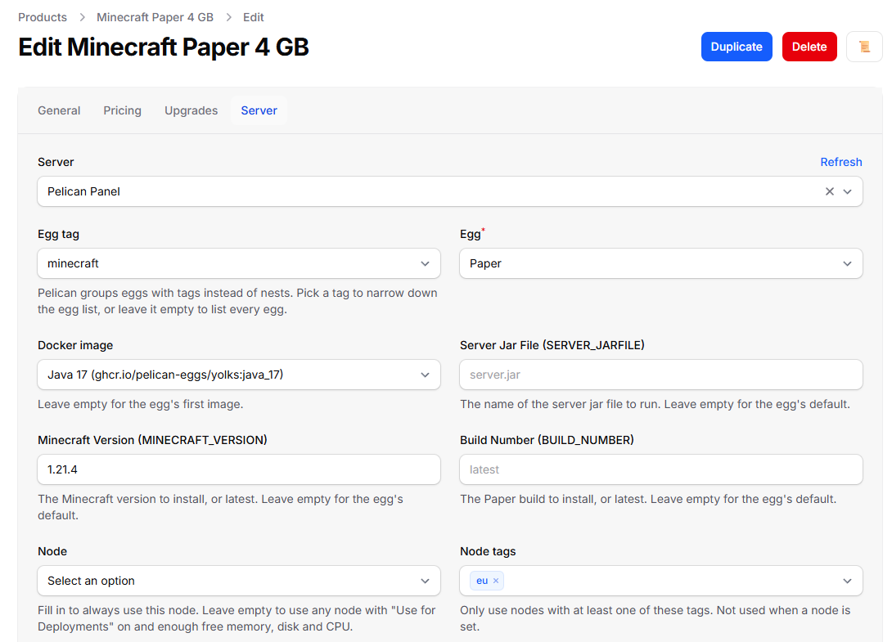
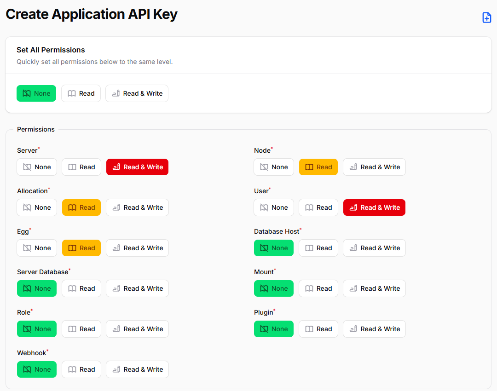
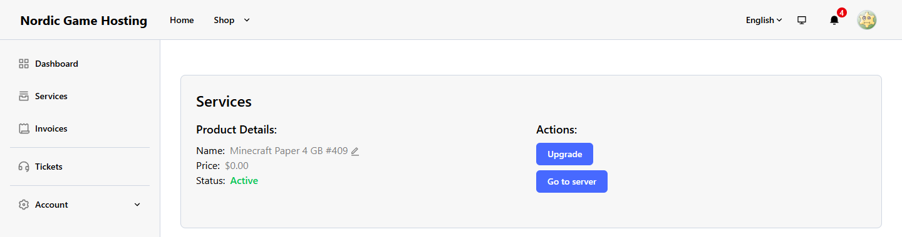

# Pelican Panel for Paymenter

**A free Paymenter server extension for [Pelican Panel](https://pelican.dev).**

When an order is paid, Paymenter creates the game server in Pelican, and it suspends, unsuspends, upgrades and
deletes it with Paymenter's own jobs. Customers get a **Go to server** button that opens their server in Pelican.

Paymenter ships extensions for Pterodactyl, Convoy, Virtfusion and others, but none for Pelican: not in Paymenter
1.5.9 and not in the `extensions/Servers` folder of Paymenter's development branch (checked on 25 October 2026).
Pelican started as a fork of Pterodactyl, but its Application API has changed: Paymenter's Pterodactyl extension
reads nests and locations, and Pelican answers `/api/application/nests` and `/api/application/locations` with
"The route ... could not be found". This extension starts from Paymenter's Pterodactyl extension and follows
Pelican's current API where it differs (see
[Differences from the Pterodactyl extension](#differences-from-the-pterodactyl-extension)).

Free and open source (MIT), made by Karelia Labs. Tested with Paymenter 1.5.9 and Pelican Panel v1.0.0-rc.2.

Download the zip from the [GitHub releases](https://github.com/ziroxonline111/paymenter-pelican/releases/latest),
[SourceXchange](https://www.sourcexchange.net/products/pelican-panel-for-paymenter) or
[Gumroad](https://karelialabs.gumroad.com/l/pelican-paymenter). All three have the same release zip.
Website: [ziroxonline111.github.io/paymenter-pelican](https://ziroxonline111.github.io/paymenter-pelican/).

## Compatibility

Tested with Paymenter 1.5.9 and Pelican Panel v1.0.0-rc.2 (the newest Pelican release on 25 October 2026). See
[Tested](#tested) for what was tested and how.

## What it does

- **Creates the server when an order is paid**, with the product's egg, Docker image, egg variables, memory, swap,
  disk, CPU, IO weight, CPU pinning, database, backup and port limits.
- **Finds or creates the customer's Pelican account** by email address. Without an account, it creates one; Pelican
  then emails the customer a link to set a password.
- **Eggs straight from Pelican**: Pelican has no nests. The product page lists every egg, can narrow the list down by
  egg tag, and shows the egg's Docker images and one field per egg variable.
- **Places the server by node tags or on a fixed node**, and picks a free port itself, with optional port ranges,
  a port array (ports for egg variables, such as a query port) and dedicated IP addresses.
- **Suspend, unsuspend, upgrade and terminate** from Paymenter's jobs (overdue invoices, cancellations, upgrades) and
  from the admin's **Trigger Extension Action**.
- **Go to server** on the customer's service page, linked to `https://your-panel/server/<short id>`.
- **Test Connection** checks the URL, the key and every read permission, and names the missing one.
- **Clear errors**: the HTTP status, the request, Pelican's reason and what to change, for example
  `Pelican answered HTTP 403 to POST /api/application/users: This action is unauthorized. The API key needs "Read & Write" for User (Pelican: Admin → Advanced → API Keys).`
- **Every page of every list** is read: Pelican sends nodes and users 50 per page unless asked for more; the
  extension asks for 100 and reads every page.

## Install

1. Download `paymenter-pelican-1.0.0.zip` from the [latest release](https://github.com/ziroxonline111/paymenter-pelican/releases/latest).
   It has the `PelicanPanel` folder at its root, as Paymenter's Upload Extension expects.
2. In Paymenter, go to **Admin → Extensions → Available Extensions → Upload Extension** and upload the zip.
   Paymenter answers "Server uploaded successfully".
   - Or copy the `PelicanPanel` folder to `extensions/Servers/` in your Paymenter directory, so that you have
     `extensions/Servers/PelicanPanel/PelicanPanel.php`.
3. Create the API key in Pelican (next section).
4. Add the panel in Paymenter (the section after it).

## Create the API key in Pelican

1. Sign in to Pelican as an administrator and open the admin area (user menu → **Admin**, or `/admin`).
2. Go to **Advanced → API Keys** and click the **+** button above the list.
3. Set the permissions. Set everything to **None** first (the **Set All Permissions** row at the top), then:

   | Permission | Level | Used for |
   |---|---|---|
   | Server | **Read & Write** | create, suspend, unsuspend, upgrade and delete servers |
   | User | **Read & Write** | find the customer's account by email, create it if there is none |
   | Node | **Read** | the node list on the product page, the nodes that can take a server |
   | Allocation | **Read** | the free ports of those nodes |
   | Egg | **Read** | the egg list, the egg's images and variables |

4. Optional: under **Whitelisted IPv4 Addresses**, enter the IP address your Paymenter server connects from.
5. Enter a description such as `Paymenter` and click **Create** (the icon at the top right of the page, or Ctrl+S).
6. Copy the key from the list of API keys (it starts with `papp_`; click it to copy it).

## Add the panel in Paymenter

1. **Admin → Servers → Create**.
2. **Name**: anything, for example `Pelican`. **Server**: `PelicanPanel`.
3. **Pelican Panel URL**: the address you open Pelican at, for example `https://panel.example.com`. Customers' **Go to
   server** button links here, so use the public address.
4. **Application API key**: the key from Pelican. Paymenter stores it encrypted.
5. Click **Create**, then **Test Connection** at the top of the form. It says **Configuration is correct**, or what to
   fix (see [Troubleshooting](#troubleshooting)).

## Set up a product

**Admin → Products → the product → Server**, choose the Pelican server, and fill in:

| Field | What it does |
|---|---|
| Egg tag | Narrows the egg list to eggs with this tag. Only a filter for the list; it is not used when the server is created. |
| Egg | The egg the server runs. |
| Docker image | One of the egg's images. Empty: the egg's first image. |
| One field per egg variable | For example **Minecraft Version (MINECRAFT_VERSION)**. Empty: the egg's default, shown in grey. |
| Node | Always use this node. Empty: any node with **Use for Deployments** on and enough free memory, disk and CPU. |
| Node tags | Only use nodes with at least one of these tags. Not used when a node is set. |
| Memory, Swap, Disk, IO Weight, CPU Limit, CPU Pinning | The server's resources, as in Pelican. 0 is unlimited (swap: -1 unlimited, 0 off). |
| Databases, Backups | How many the customer may create. |
| Additional Allocations | Ports the customer may add in Pelican on top of the ones the server gets. |
| Port Array | Optional JSON that gives egg variables their own ports, for example `{"SERVER_PORT": 2456, "QUERY_PORT": 2457, "NONE": [2458]}`. `SERVER_PORT` is the main port; a port under a variable's name is written to that variable; `NONE` ports are only assigned. If a port is taken, the next higher free port is used. |
| Port ranges | Only use these ports: single ports or ranges like `25565-25600`. Not used with a port array. |
| Skip Egg Install Script, Start on completion, Enable OOM Killer | As in Pelican. |
| Dedicated IP | Only use ports on an IP address that no other server on the node uses. |

### How a server is placed

1. The extension asks Pelican which nodes can take the server: nodes with **Use for Deployments** on and enough free
   memory, disk and CPU (Pelican counts each node's overallocation), and with one of the product's node tags.
   With a fixed node, only that node is asked for, without the tags.
2. It takes the first of those nodes that has enough free ports (within the port ranges, on an unused IP address for
   a dedicated IP), and gives the server the lowest free port, or the ports of the port array.

Pelican's own automatic deployment only gives a server a port when a port range is sent, so the extension always
chooses the port itself.

### Config options and checkout fields

As with Paymenter's Pterodactyl extension, a config option (or a checkout field) whose **environment variable** is
the name of a product setting or an egg variable overrides it for that order. For example a config option
`memory` with values `4096` and `8192` lets the customer choose the memory, and a config option `MINECRAFT_VERSION`
sets that egg variable. `docker_image` sets the image and `servername` the server's name in Pelican.

For egg variables, the first value found is used: the config option, the product's field, the egg's default.

### Upgrades

When a customer upgrades (or you click **Trigger Extension Action → Upgrade server**), the same Pelican server gets the
new product's resources and limits. Its egg variables keep the values the server already has, so changes the customer
made in Pelican stay. If the new product uses another egg, the server is moved to that egg with the egg's startup
command and image (or the product's Docker image); Pelican does not reinstall it by itself.

## What customers see

- **Go to server** on their service page in Paymenter. It opens the server in Pelican; if they are not signed in to
  Pelican, Pelican asks them to sign in first and then shows the server's console.
- A Pelican account with the same email address as in Paymenter. If it was created for the order, Pelican emails a
  link to set the password (your Pelican needs working mail settings for that).

## Differences from the Pterodactyl extension

| | Paymenter's Pterodactyl extension (1.5.9) | This extension on Pelican |
|---|---|---|
| Eggs | Nest, then egg | Eggs directly (Pelican has no nests), optional egg tag filter |
| Where servers go | Locations, or a node | Node tags (Pelican has no locations), or a node |
| The server's port | Pterodactyl's automatic deployment picks one | The extension picks one: Pelican's automatic deployment gives no port without a port range |
| Egg variables | Config options named after the variable | The same, plus a field per variable on the product page |
| Docker image | The egg's image, or a `docker_image` config option | A select with the egg's images, and the config option |
| Finding the customer's account | The first result of the panel's email filter | The account with exactly that email address, on any page: Pelican's filter also matches parts of addresses (`info@example.com` also finds `shopinfo@example.com`) |
| Lists on the product page | The first page | Every page |
| New panel users | First and last name | Pelican has no name fields: a username from the customer's name |
| Allocation limit after an upgrade | Only the additional allocations | The server's ports plus the additional allocations, the same as at creation |
| A server deleted in the panel | Terminate fails | Terminate succeeds (nothing left to delete) |
| API key | `ptla_…`, permissions in the plural | `papp_…`, Pelican's permissions Server, User, Node, Allocation, Egg |

Products cannot be moved from the Pterodactyl extension to this one as they are: Pelican's eggs, nodes and tags are
set up separately, so set the egg and the node tags on each product again.

## Troubleshooting

| Message | What to do |
|---|---|
| `Pelican answered HTTP 401 ... The API key was not accepted` | Copy the whole key again from Pelican's list of API keys. Use an Application API key (Admin → Advanced → API Keys), not a key from your account page. |
| `Pelican answered HTTP 403 ... The API key needs "Read" for Allocation` (or another permission) | Create a key with the permissions in the table above. Pelican cannot change the permissions of an existing key. |
| `Pelican answered HTTP 403 ... This IP address (…) does not have permission` | The key has an IP whitelist without Paymenter's address. |
| `Could not connect to …` | Paymenter cannot reach the URL: check it, and that the Paymenter server can resolve and reach it. |
| `This address does not look like a Pelican Panel` | The URL points at another site. Use the address you open Pelican at, without `/admin`. |
| `No node can take this server: ...` | No node with **Use for Deployments** on has the free memory, disk and CPU the product asks for, or none has one of the product's node tags. Add capacity, raise the node's overallocation, or change the tags. |
| `Node "…" has "Use for Deployments" turned off in Pelican` | The product's fixed node is not used for deployments. Turn it on under the node's settings in Pelican, or choose another node. |
| `Node "…" does not have … free` | The product's fixed node is full. |
| `Not enough free allocations: ...` | Add ports (allocations) to the node in Pelican (Admin → Nodes → the node), or widen the product's port ranges. |
| `The product's port array must be JSON with one SERVER_PORT ...` | Fix the port array, for example `{"SERVER_PORT": 2456, "QUERY_PORT": 2457}`. |
| `Pelican answered HTTP 422 ...` | Pelican refused a value, for example an egg variable that does not pass the egg's rules. The message names it; set it on the product or in a config option. |
| `Pelican already has a server for this service` | The service already has a server in Pelican (Pelican stores the Paymenter service ID as the server's external ID). |
| `Pelican has no server for this service` | The server was deleted in Pelican. Create it again with **Trigger Extension Action → Create server**. |
| **Go to server** shows 404 in Pelican | The browser is signed in to Pelican as a user who does not own the server. Pelican answers 404 for servers of other users. Sign out of Pelican, or sign in as the customer. |
| No **Go to server** button | The service is not active, or its server was deleted in Pelican. |
| The product page shows an error instead of the fields | The message is Pelican's answer; usually the key or the URL. Click **Refresh** next to the server after fixing it. |

## Uninstall

1. Point every product that uses the Pelican server to another server, or delete those products.
2. **Admin → Servers**, delete the Pelican server.
3. Delete the folder `extensions/Servers/PelicanPanel`.

The extension creates no database tables. Servers and accounts it created in Pelican stay in Pelican.

## Tested

Against Paymenter 1.5.9 (Docker image, MariaDB 11.4) and Pelican Panel v1.0.0-rc.2 (official Docker image, SQLite),
with a stand-in for Wings that accepts every request, on 25 October 2026:

- install from the release zip with **Upload Extension**, the server form (the key stored encrypted) and **Test
  Connection** with a good key, a wrong key, a host that does not exist, the URL of another web app, an address that
  answers JSON to everything and a key without a permission;
- the product page: eggs, egg tags, images, egg variables, 108 nodes over two pages and their tags, saving;
- an order in the shop that creates the server with the right egg, image, limits, port, variables and owner (found on
  page 2 of 106 partial email matches); **Go to server** into the server's console;
- suspend, unsuspend and terminate from the admin, the customer's upgrade to a bigger product;
- node tags, port ranges, dedicated IP, port arrays, config options, a new customer account, a change of egg;
- every error message in the table above that the extension writes itself.

Real Wings nodes, Pelican's mail and other Paymenter or Pelican versions were not tested.

## FAQ

**Does the customer get a Pelican password?**
If the account is new, Pelican emails a link to set one (Pelican needs working mail settings). Existing accounts with
the same email address are used as they are.

**Why does "Go to server" show 404 in Pelican?**
The browser is signed in to Pelican as someone who does not own the server; Pelican answers 404 for other users'
servers. Sign out or sign in as the customer.

**Can customers choose the memory or a game version?**
Yes, with Paymenter config options whose environment variable is `memory` (or another product setting) or the egg
variable's name, such as `MINECRAFT_VERSION`.

**Does it reinstall a server on upgrade?**
No. It changes the resources of the same server. A product with another egg moves the server to that egg; Pelican
does not reinstall it by itself.

**Does it work with Pterodactyl?**
Use Paymenter's Pterodactyl extension for Pterodactyl 1.x. This one is for Pelican.

## More for Paymenter hosts

- **[Free Trials for Paymenter](https://karelialabs.gumroad.com/l/free-trials-paymenter)** (paid) lets people try a
  server before they buy it: one trial per person, a reminder before it ends, suspend and terminate afterwards, and an
  **Upgrade and keep my server** button. It works with any Paymenter server extension that supports suspend,
  unsuspend and terminate (and upgrade, when the trial converts to another product); it was tested with the
  Pterodactyl 2.0 server extension.
- **[Pay All Invoices](https://karelialabs.com/tools/paymenter-pay-all-invoices)** (free) lets clients pay all their
  unpaid invoices with one payment and one gateway fee.

More tools: [karelialabs.com](https://karelialabs.com) ·
[Pelican Panel for Paymenter on karelialabs.com](https://karelialabs.com/tools/pelican-panel-for-paymenter)

## Feedback and support

Found a bug or a Pelican version it does not work with? [Open an issue](https://github.com/ziroxonline111/paymenter-pelican/issues),
or ask on the product's SourceXchange page. Please include the message Paymenter showed, your Paymenter version and
your Pelican version.

## License

MIT, see [LICENSE](LICENSE). Based on Paymenter's built-in Pterodactyl extension (MIT, © Paymenter).

Not affiliated with Paymenter or Pelican. "Paymenter", "Pelican" and "Pterodactyl" are used only to describe
compatibility.
